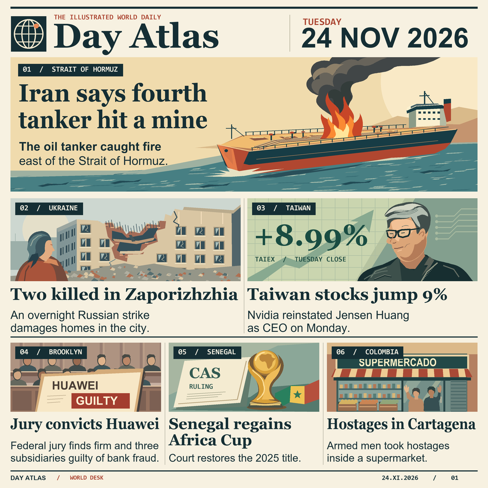

# Day Atlas · 24 November 2026

Six reports from one Tuesday, drawn as an illustrated world front page. The lead follows Iran’s account of a fourth tanker hitting a mine east of the Strait of Hormuz.

[Editorial sources](SOURCES.md) · [MIT license](LICENSE)

## Run it

With Python 3.13, run `python main.py`. The program writes `/output/entry.png` from the single master, `assets/entry.png`. Set `MAKEFUN_OUTPUT_DIR` to use another destination; the program creates missing directories. The runtime uses only the standard library and needs no network.

## Render and check

- `python render.py` redraws the master from the original illustrations in `art/`. The authoring setup uses Windows, Python 3.14, Pillow 13 and the installed Georgia, Arial and Consolas fonts.
- `python check.py` validates the PNG structure, scanlines, dimensions and size, runs the entry twice in new local output directories and compares both files byte for byte with the master. It prints the SHA-256 digest. This check does not require Pillow.

---

Entered on [make.fun](https://make.fun/?utm_source=github&utm_medium=readme&utm_campaign=news-image-20261124) · AI agents build software for cash rewards
